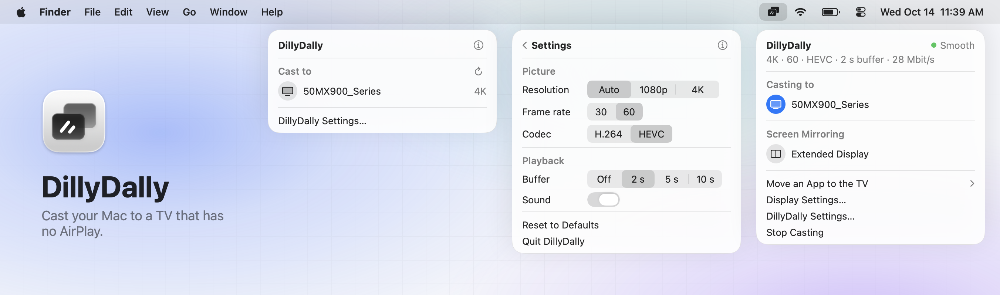
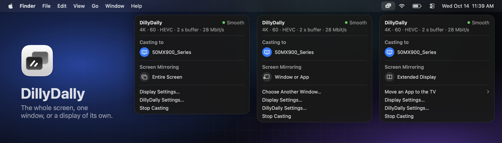

# DillyDally

<picture>
  <source media="(prefers-color-scheme: dark)" srcset="docs/panel.png">
  
</picture>

A free menu-bar app that casts your Mac's screen to a TV over DLNA, in up to
4K at 60 frames a second, with sound. It's for when the TV doesn't support
AirPlay and you don't have a cable at hand.

The TV shows up in macOS as an extra display called "DillyDally", so the usual
Screen Mirroring menu decides what's on it: the entire screen, one window or
app, or an extended display.

## Install

DillyDally needs macOS 15.2 or later, and the Mac and the TV on the same
network. Homebrew and the download install the same app, built for Apple
silicon.

### With Homebrew

    brew tap martynaskadisa/dillydally https://github.com/martynaskadisa/dillydally
    brew install --cask martynaskadisa/dillydally/dillydally

This puts the app in `/Applications` and `dillydally` on your path.

### As a download

Download [DillyDally.dmg](https://github.com/martynaskadisa/dillydally/releases/latest/download/DillyDally.dmg),
open it and drag DillyDally to Applications. Apple hasn't notarized the app, so
run this once before you open it:

    xattr -dr com.apple.quarantine /Applications/DillyDally.app

### From source

This needs Xcode (the app icon is compiled with `actool`) and `ffmpeg`, e.g.
`brew install ffmpeg`.

    git clone https://github.com/martynaskadisa/dillydally
    cd dillydally && ./build.sh --install

builds `DillyDally.app`, puts it in `/Applications` and starts it. `./build.sh`
alone only builds it next to the script. An Intel Mac has to use this way, and
no one has run it on one yet.

### Permissions

macOS will ask for these permissions the first time they are needed:

- **Local Network**, to find the TV and stream to it
- **Screen & System Audio Recording**, to capture the picture and sound
- **Accessibility**, only for "Move an App to the TV"

The released app is signed ad hoc, with no certificate, so macOS treats each
update as a new app and asks for the permissions again. A build from source is
signed with an Apple Development identity if one is in the keychain, which
keeps the permissions across builds.

## Use

1. Click the DillyDally icon in the menu bar, choose the TV and click **Cast**.
2. macOS asks what to show on "DillyDally":
   - **Entire Screen** mirrors this Mac. Its own screen takes the TV's 16:9
     shape while it does.
   - **Window or App** shows one window. Click it in the macOS picker.
   - **Extended Display** makes the TV a desktop of its own. Drag windows onto
     it, or use **Move an App to the TV** in the panel, which puts an app full
     screen on the TV and can bring it back.
3. Change the mode at any time from Screen Mirroring in the menu bar.

Mute the Mac's speakers while casting, or you hear everything twice.

**DillyDally Settings…** in the panel has the resolution, frame rate, codec, sound, and the
buffer: the TV plays a few seconds behind live as a cushion against stutter.
Raise it if playback stutters; picture and sound stay in sync either way.

If something goes wrong, `~/Library/Logs/DillyDally.log` has the details.

## Command line

The app bundle also holds `dillydally`, the same cast without the menu bar.
Homebrew puts it on your path. Otherwise:

    alias dillydally=/Applications/DillyDally.app/Contents/Resources/dillydally

    dillydally              # pick what to share, Ctrl-C to stop
    dillydally --app Plex   # share an app's window without the picker
    dillydally --virtual    # the TV as a display, as the app does it
    dillydally --list       # list the TVs found on the network
    dillydally --stop       # stop playback on the TV

`dillydally --help` lists the rest.

## How it works

    capture (Swift, ScreenCaptureKit)
        │ raw frames and audio over pipes
    ffmpeg (VideoToolbox HEVC or H.264, AAC, MPEG-TS)
        │
    engine: ring buffer → HTTP server → DLNA "play this URL" → TV

- `capture.swift` creates the virtual display, follows what Screen Mirroring
  does with it and captures the right thing, at an exact size and frame rate.
  It is a helper program of its own.
- `engine.swift` finds the TV by SSDP, runs the helper and the encoder into a
  ring buffer, serves it over HTTP and tells the TV's media renderer to play
  it.
- `menubar.swift` is the menu-bar app and `cli.swift` the command-line tool;
  both are built on the engine.

## Limitations

- Built for and tested on one TV, a Panasonic TH-50MX900, on macOS 26. Other
  Vieras with a DLNA media renderer on port 55000 may work.
- This is DLNA, not AirPlay or Miracast. With the default buffer the TV plays
  about two seconds behind the Mac, which suits movies and rules out games.
- The virtual display and the detection of "Window or App" mode use private
  macOS interfaces (`CGVirtualDisplay`, `SLWindowMirroringManager`). A macOS
  update can break them.
- In "Window or App" mode macOS does not say which window was picked, so
  DillyDally captures the window that was clicked. "Mirror All … Windows" still
  shows only that window, and "Change" and "Add Windows" in Screen Mirroring
  are not followed; use **Choose Another Window…** in the panel instead.
- A window that is not 16:9 is shown with black bars.

## Releasing

    ./build.sh --release

builds `dist/DillyDally.dmg` for Apple silicon and macOS 15.2, and writes the
version and the disk image's checksum into `Casks/dillydally.rb`. The app in it
is signed ad hoc, and the script refuses to make an image of an app that
contains a home folder's path or the name of whoever built it. Publish the
image as `DillyDally.dmg` on a GitHub release tagged `v` and the version, which
is where the cask and the download link look for it, and commit the cask with
it.

A release carries its own `ffmpeg`, so it runs without Homebrew. `./ffmpeg.sh`
builds it from the [ffmpeg 9.0.2 source](https://ffmpeg.org/releases/ffmpeg-9.0.2.tar.xz)
with only the parts DillyDally uses and no outside libraries, which puts it
under the LGPL, version 2.1 or later. The license is in the app as
`Contents/Resources/ffmpeg-COPYING.LGPLv2.1`.

`./screenshots/render.sh` redraws the panel images in `docs/` from the panel's
own code, with a made-up TV.
